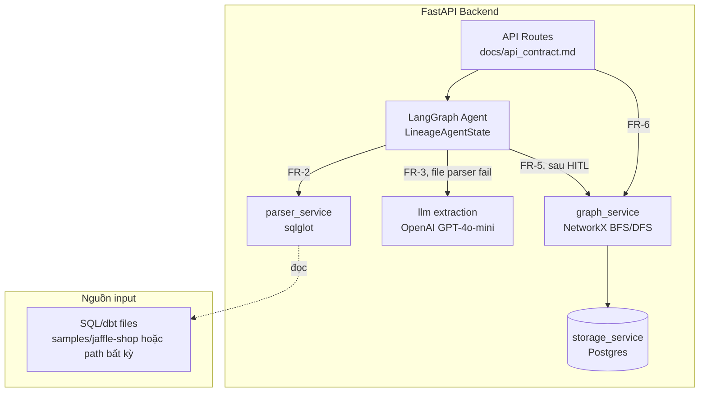
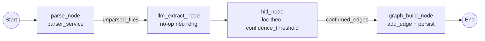
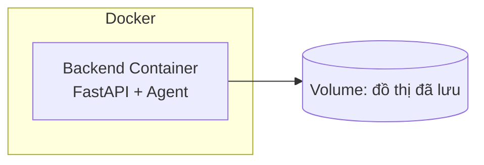

# Architecture Document — DATA-04 Data Lineage Agent

## System Overview

AI Agent đọc code SQL/dbt từ 1 path do người dùng chỉ định, trích quan hệ phụ thuộc bằng parser trước (sqlglot) và LLM khi parser fail, sau khi con người xác nhận các cạnh confidence thấp (HITL) thì ghi vào đồ thị lineage (NetworkX) — phục vụ impact analysis và chatbot lineage qua API.

## Architecture Diagram

Đồ thị lineage **tách biệt hoàn toàn khỏi database production** — là sản phẩm agent tạo ra, không phải nơi agent đọc dữ liệu thật (xem PRD.md mục 4).

## Agent Flow (LangGraph)

Đã implement thật trong `src/agents/graph.py` (2026-08-06), đơn giản hơn 1 chút so với thiết kế ban đầu:

`hitl_node` **không** dùng LangGraph interrupt để pause chờ người — nó chỉ phân loại `confirmed_edges` (>= threshold) vs `pending_review` (< threshold) trong 1 lần chạy đồng bộ. Cạnh `pending_review` được API layer (`routes.py`) đẩy vào `review_service` (hàng đợi in-memory), người dùng xác nhận/từ chối qua `POST /pending-review/{edge_id}/confirm|reject` — 1 request riêng, không phải giữa chừng 1 lần chạy graph. Không có `answer_node` riêng — `routes.py` tự đọc state cuối cùng để dựng `IngestResponse`, không cần thêm 1 node chỉ để format response.

State chạy xuyên suốt: `LineageAgentState` (`src/agents/state.py`). Chi tiết field từng bước xem PRD.md mục 6 (FR-1..FR-7).

## Components

### 1. Backend (FastAPI)
- **Purpose:** expose agent qua REST, validate input bằng Pydantic
- **API Design:** RESTful, chi tiết endpoint xem `docs/api_contract.md`
- **Authentication:** Không có (ngoài phạm vi MVP — xem PRD.md mục 9)

### 2. AI Agent (LangGraph)
- **Agent Type:** Custom state graph (không phải ReAct) — pipeline tuyến tính có rẽ nhánh theo confidence
- **State:** `LineageAgentState` (`src/agents/state.py`)
- **Nodes:** `parse_node`, `llm_extract_node`, `hitl_node`, `graph_build_node` (`src/agents/nodes/lineage_nodes.py`)
- **Tools:** không dùng @tool wrapper — node gọi thẳng `parser_service`/`llm_extraction_service`/`graph_service`. Đây là pipeline tất định (deterministic), không phải ReAct agent tự chọn tool, nên không cần lớp @tool trung gian

### 3. Đồ thị lineage (thay cho "Database" truyền thống)
- **Traversal:** NetworkX `MultiDiGraph` in-memory (BFS/DFS trong `graph_service.py`) — đủ nhanh cho quy mô charter (10-15 pipeline), không cần recursive CTE
- **Persist:** Postgres (bảng `lineage_edges`, xem `storage_service.py`) — `save()` ghi đè toàn bộ snapshot, `load()` dựng lại `MultiDiGraph` lúc khởi động. Lý do dùng DB thật thay vì file GraphML: nếu deploy nhiều worker process, mỗi worker giữ `_graph` riêng trong RAM — Postgres là nguồn sự thật chung, tránh lệch dữ liệu giữa các worker
- **Lưu ý:** `add_edge()` hiện chưa tự gọi `storage_service.save()` sau khi mutate — ai nối API `/ingest` thật cần tự gọi `save()` sau khi ghi xong 1 batch để không mất dữ liệu khi restart
- **Migrations:** N/A hiện tại (1 bảng, tạo tự động qua `CREATE TABLE IF NOT EXISTS` trong `storage_service.py`); cân nhắc Alembic nếu schema phức tạp hơn

### 4. Chatbot lineage
- **Purpose:** bounded tool-loop agent cho downstream/upstream lineage. `agent_node` chọn schema tool, `tools_node` resolve tên bảng tất định và gom facts, sau đó `compose_node` diễn giải và `verify_node` kiểm grounding.
- **Session:** in-memory TTL store tại `src/agents/chat/session.py`; backend phải chạy một process, cùng giới hạn hiện có của `review_service`. Reply làm rõ được match tất định và gọi thẳng tool đã chặn, không gọi agent LLM lần nữa.
- **API mapping:** `chat_service.answer_question()` chỉ quản lý session, gọi `build_chat_graph()` và map accumulated state sang `ChatResponse`; response giữ confirmed/pending tách biệt và thêm `steps`.

### 5. Vector Store
- **Không dùng trong dự án này.** `chroma_persist_dir` trong `config.py` là leftover từ template gốc (dành cho RAG chatbot) — lineage agent không cần embedding/similarity search

## Data Flow

1. User gửi `input_path` qua `POST /ingest` (FR-1, không có bước tự dò tìm)
2. `parse_node` gọi `parser_service.parse_file_with_diagnostics()` (sqlglot) cho từng file SQL/dbt — trả kèm lý do fail nếu có, và gắn `evidence` (file_path/raw_sql/line_range) vào mọi cạnh đọc được
3. File parser đọc được → cạnh confidence=1.0 kèm evidence; file fail (vd dbt Jinja chưa xử lý, xem `samples/jaffle-shop/README.md`) → đưa qua `llm_extract_node` kèm lý do fail (`fallback_reason`)
4. `llm_extract_node` gọi LLM, kết quả kèm `reasoning` (tại sao LLM suy luận ra) + `fallback_reason` nhận từ bước trên, gắn vào `evidence`
5. Cạnh confidence < `confidence_threshold` (config, mặc định 0.8) → vào hàng đợi HITL (`review_service`), chờ người xác nhận qua API
6. Cạnh đã xác nhận (parser hoặc HITL approve) → `graph_service.add_edge()` ghi vào đồ thị chính thức, `persist()` xuống Postgres
7. `POST /ingest` trả kèm `overview_graph` — table-level, chỉ các bảng vừa phát hiện lượt này — client không cần gọi thêm API nào để thấy bức tranh tổng đầu tiên
8. User truy vấn `GET /impact/{table}` → response tách 2 khối riêng biệt: `confirmed` (parser hoặc đã qua HITL) và `inferred_pending` (LLM confidence thấp, chưa duyệt, luôn kèm evidence) — không bao giờ gộp chung (US-3, US-4)
9. Xác nhận 1 cạnh HITL xong, lần `GET /impact` tiếp theo tự thấy cạnh đó chuyển từ `inferred_pending` sang `confirmed` — không cần re-ingest
10. `GET /graph` trả toàn bộ đồ thị tích luỹ (khác `overview_graph` chỉ show lượt ingest gần nhất) để vẽ trực quan
11. `POST /chat` chạy bounded agent loop với hai capability `downstream` và `upstream`; tool result được gom trong state trước khi compose câu trả lời grounded

## Deployment Architecture

Backend deploy dạng Docker (Render/Railway theo gợi ý template). Frontend hiện không nằm trong repository.

## Security

- Agent không kết nối ghi vào database production; nếu cần verify schema chỉ query `information_schema` qua kết nối read-only riêng biệt (PRD.md mục 4)
- API keys trong `.env` (không commit — đã kiểm tra `.gitignore`)
- Input validation qua Pydantic (`IngestRequest`, `LineageEdge`...)
- Không có auth/rate limiting trong MVP — ghi nhận là gap, ngoài phạm vi theo PRD.md mục 9

## Design Decisions

| Decision | Choice | Reason |
|----------|--------|--------|
| Framework | FastAPI | Async, auto-docs, type-safe (theo template) |
| Agent | LangGraph | Cần rẽ nhánh theo confidence + trạng thái chờ HITL, không phải chatbot ReAct đơn giản |
| Graph storage | NetworkX (traversal) + Postgres (persist) | BFS/DFS đủ nhanh in-memory ở quy mô charter; Postgres giải quyết vấn đề nhất quán dữ liệu giữa nhiều worker process — quyết định 2026-08-06 |
| SQL dialect | Postgres | Mặc định team chọn, mở rộng sau nếu còn thời gian |
| Test data | `samples/jaffle-shop` (dbt-labs mã nguồn mở) | Không chờ đối tác thật — quyết định 2026-08-05, xem PRD.md mục 8 |
| LLM | OpenAI GPT-4o-mini | Mặc định template, dùng cho case parser fail (FR-3) |
| Chat session | In-memory TTL store | Phù hợp MVP một process; không dùng LangGraph checkpointer vì mỗi lượt chat là request riêng |
| Frontend | Removed from repository | Frontend chat/graph UI is outside the current API-only MVP |
