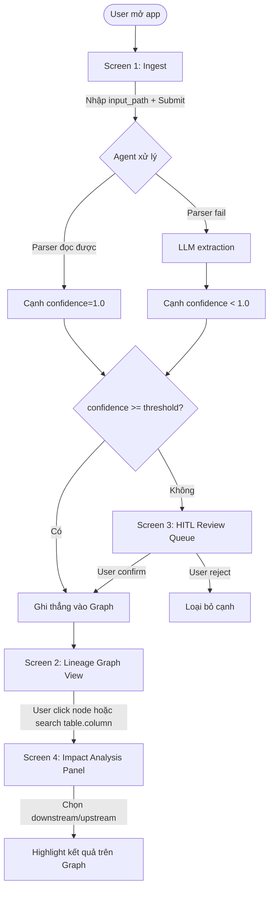

# Wireframe / UI Flow — DATA-04: Data Lineage Agent

> Gate G1 deliverable. Wireframe dạng low-fidelity (ASCII) + user flow (Mermaid) — đủ để thống nhất bố cục trước khi code frontend thật bằng React + react-flow.

## 1. User Flow tổng quát



## 2. Screen 1 — Ingest

```
┌──────────────────────────────────────────────────────┐
│  Data Lineage Agent                        [Settings] │
├──────────────────────────────────────────────────────┤
│                                                        │
│   Nhập đường dẫn folder / repo SQL cần phân tích:     │
│   ┌────────────────────────────────────────────────┐ │
│   │ /path/to/dbt-project  hoặc  git-url             │ │
│   └────────────────────────────────────────────────┘ │
│   Dialect: [ Postgres ▾ ]                             │
│                                                        │
│                              [  Bắt đầu phân tích  ]  │
│                                                        │
│   ── Trạng thái xử lý ─────────────────────────────   │
│   ✔ Đã tìm thấy 42 file .sql                          │
│   ✔ Parser xử lý xong 36 file (sqlglot/sqllineage)    │
│   ⚠ 6 file cần LLM hỗ trợ (dynamic SQL / Jinja macro) │
│   ⏳ Đang chờ xác nhận 4 cạnh confidence thấp →        │
│      [Xem hàng đợi HITL]                              │
└──────────────────────────────────────────────────────┘
```

Ghi chú: `input_path` là field bắt buộc, không có nút "auto-discover database" — đúng nguyên tắc "input luôn tường minh" trong PRD.

## 3. Screen 2 — Lineage Graph View (react-flow)

```
┌──────────────────────────────────────────────────────┐
│ [🔍 Tìm bảng/cột...]              [Downstream|Upstream]│
├──────────────────────────────────────────────────────┤
│                                                        │
│   ┌──────────┐        ┌──────────┐       ┌─────────┐ │
│   │raw.orders│──────▶│stg_orders │──────▶│fct_sales│ │
│   └──────────┘        └──────────┘       └─────────┘ │
│                              │                        │
│                              ▼                        │
│                       ┌──────────┐                    │
│                       │dim_orders│                    │
│                       └──────────┘                    │
│                                                        │
│  Chú thích:  ── cạnh từ parser (confidence=1.0)       │
│              ╌╌ cạnh từ LLM (confidence<1.0, đã xác  │
│                 nhận)                                 │
│                                                        │
│  [Click 1 node] → mở panel bên phải (Screen 4)        │
└──────────────────────────────────────────────────────┘
```

## 4. Screen 3 — HITL Review Queue

```
┌──────────────────────────────────────────────────────┐
│  Hàng đợi xác nhận (4 cạnh chờ duyệt)                 │
├──────────────────────────────────────────────────────┤
│  stg_orders.total → fct_sales.revenue                │
│  Nguồn: LLM  |  Confidence: 0.62  |  transform: agg  │
│  Trích đoạn SQL: "SUM(total) AS revenue ..."          │
│                          [ ✔ Xác nhận ]  [ ✘ Từ chối ]│
│  ──────────────────────────────────────────────────  │
│  raw.customers.email → dim_customers.contact          │
│  Nguồn: LLM  |  Confidence: 0.71  |  transform: direct│
│                          [ ✔ Xác nhận ]  [ ✘ Từ chối ]│
└──────────────────────────────────────────────────────┘
```

## 5. Screen 4 — Impact Analysis Panel

```
┌──────────────────────────────────────────────────────┐
│  Impact Analysis: stg_orders.total                    │
├──────────────────────────────────────────────────────┤
│  ○ Downstream (ai bị ảnh hưởng nếu sửa cột này)       │
│  ● Upstream (cột này được tính từ đâu)                │
│                                                        │
│  → raw.orders.amount        (parser, confidence 1.0)  │
│  → raw.orders.discount      (parser, confidence 1.0)  │
│                                                        │
│  [ Highlight trên Graph ]                             │
└──────────────────────────────────────────────────────┘
```

## 6. Responsive & Accessibility (theo tiêu chí chấm điểm UI/UX của BTC)

- Layout 2 cột (Graph + Panel) thu gọn thành xếp chồng (stack) trên mobile/tablet
- Dark mode bắt buộc (toggle ở góc trên phải, cạnh `[Settings]`)
- Contrast đủ cho 2 loại cạnh (parser vs LLM) không chỉ dựa vào màu — có ký hiệu đường nét khác nhau (nét liền/nét đứt) để phân biệt cả khi color-blind

## 7. Mapping sang component thật (khi Hoàng code frontend)

| Wireframe screen | Component (dự kiến) |
|---|---|
| Screen 1 — Ingest | `IngestForm`, `ParseStatusPanel` |
| Screen 2 — Graph View | `LineageGraph` (react-flow wrapper) |
| Screen 3 — HITL Queue | `HitlReviewList`, `HitlReviewItem` |
| Screen 4 — Impact Panel | `ImpactAnalysisPanel` |
