# Manual Test Cases — DATA-04 Lineage AI

> Test tay **trên sản phẩm cuối (frontend thật)**, không phải gọi thẳng API — click chuột, gõ phím, đọc kết quả hiển thị trên UI như người dùng thật sẽ làm. Chạy trên backend live (Postgres thật, LLM thật qua OpenRouter — không mock), ngày 2026-08-17. Format theo chuẩn manual test case (Test ID / Steps / Pre-conditions / Expected / Actual / Status), mỗi bước có ảnh chụp màn hình thật đính kèm.
>
> Dữ liệu nguồn: `samples/jaffle-shop` (dbt project mã nguồn mở, dữ liệu test chính thức của dự án theo `docs/PRD.md`). Ảnh gốc: [`manual_test_screenshots/`](manual_test_screenshots/).

---

## TC-01 — Ingest 1 dbt project thật qua giao diện Upload File

| | |
|---|---|
| **Test Case** | Vào "Analyze Data", chọn nhiều file `.sql` thật từ máy, xác nhận UI báo đúng kết quả ingest |
| **Pre-conditions** | Đồ thị đã xoá sạch. Đứng ở trang Lineage Explorer |
| **Steps** | 1. Mở app, quan sát Lineage Explorer trống 2. Bấm icon "⇪ Analyze Data" trên TopBar 3. Ở tab "Upload File", bấm "📄 Chọn file .sql", chọn 15 file trong `samples/jaffle-shop` (cả `models/staging/` và `models/marts/`) 4. Đợi xử lý xong, đọc kết quả hiển thị |
| **Expected Results** | Popup hiện "Analysis complete ✓" kèm số file, số quan hệ, breakdown Confirmed/Pending Review/LLM fallback |
| **Actual Results** | 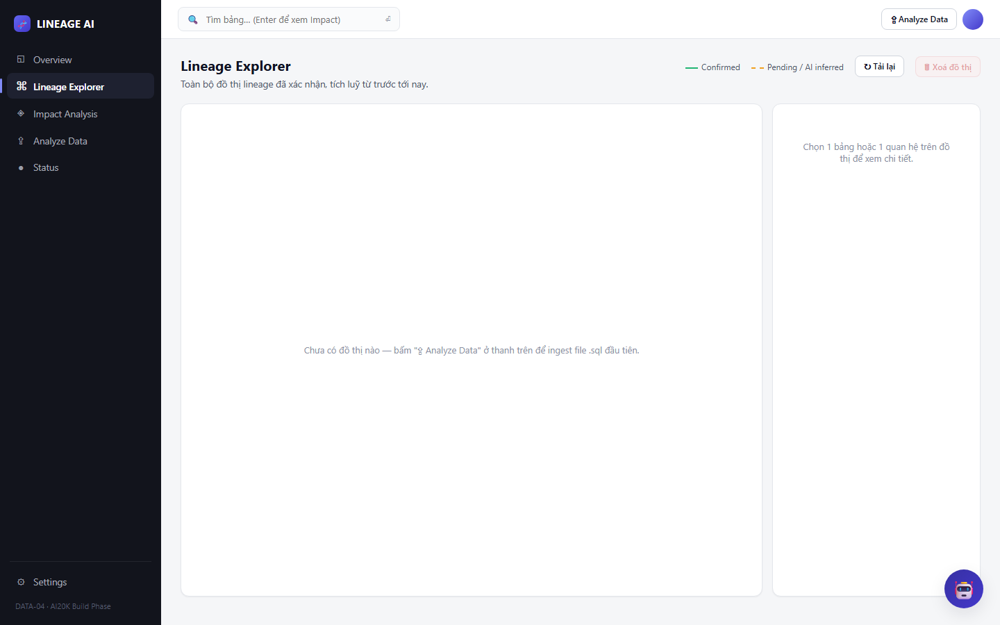 *Bước 1: Lineage Explorer trống trước khi ingest*  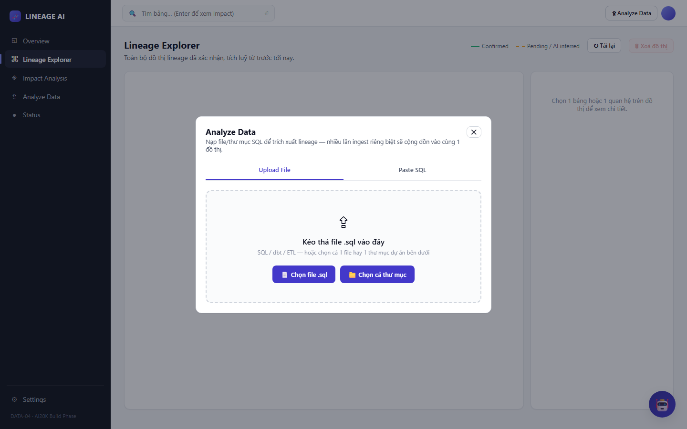 *Bước 2-3: popup "Analyze Data", tab Upload File*  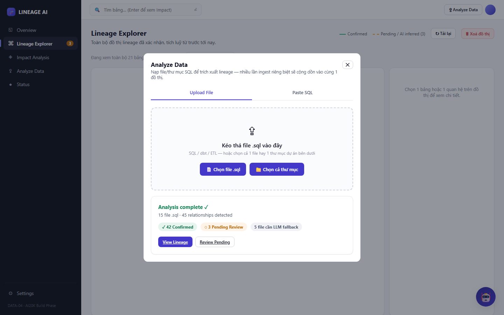 *Bước 4: "Analysis complete ✓ — 15 file .sql · 45 relationships detected — ✓ 42 Confirmed · ◌ 3 Pending Review · 5 file cần LLM fallback"* |
| **Status** | ✅ PASS |

---

## TC-02 — Impact Analysis downstream trên bảng có quan hệ thật (`stg_orders`)

| | |
|---|---|
| **Test Case** | Nhập tên bảng, bấm Analyze, xác nhận đồ thị + Impact Summary hiển thị đúng quan hệ downstream thật |
| **Pre-conditions** | Đã chạy xong TC-01 |
| **Steps** | 1. Vào "Impact Analysis" (sidebar) 2. Gõ `stg_orders` vào ô tìm bảng 3. Bấm "Analyze" (mặc định chiều Downstream) |
| **Expected Results** | Đồ thị con hiện đúng các bảng đọc từ `stg_orders`; khung "Impact Summary" phía dưới hiện đúng số lượng confirmed/pending |
| **Actual Results** | 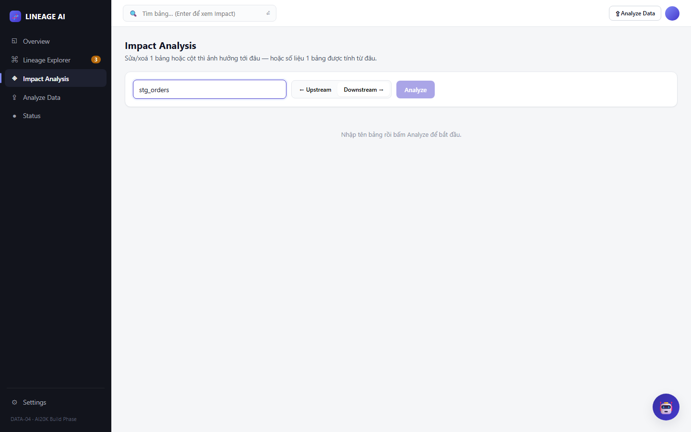 *Nhập "stg_orders"*  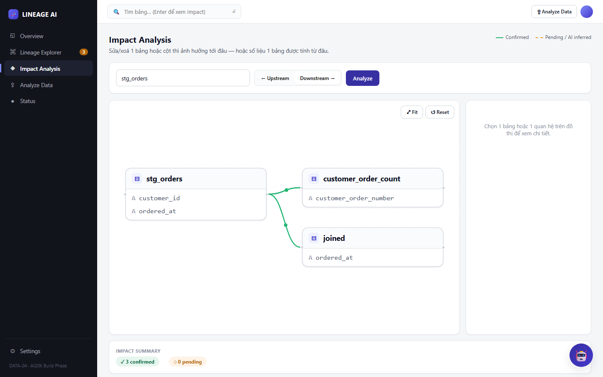 *Đồ thị hiện `stg_orders → customer_order_count` và `stg_orders → joined` (2 cạnh xanh liền nét); Impact Summary: "✓ 3 confirmed · ◌ 0 pending"* |
| **Status** | ✅ PASS |

---

## TC-03 — Chatbot trả lời câu hỏi tổng quát "liệt kê quan hệ đang pending"

| | |
|---|---|
| **Test Case** | Hỏi chatbot 1 câu **không nhắm vào bảng cụ thể nào** — regression test cho bug thật đã fix (agent từng báo sai "không có dữ liệu" vì không tool nào trả lời được câu hỏi không có tên bảng, xem PR #43) |
| **Pre-conditions** | Đã chạy xong TC-01 (3 quan hệ pending thật) |
| **Steps** | 1. Bấm icon 🤖 (Lineage Copilot) góc dưới-phải 2. Gõ: *"Cho tôi danh sách các quan hệ đang chờ duyệt (pending)"* 3. Bấm Gửi |
| **Expected Results** | Agent liệt kê đúng 3 cạnh pending thật, kèm % tin cậy, đường dẫn evidence file |
| **Actual Results** | 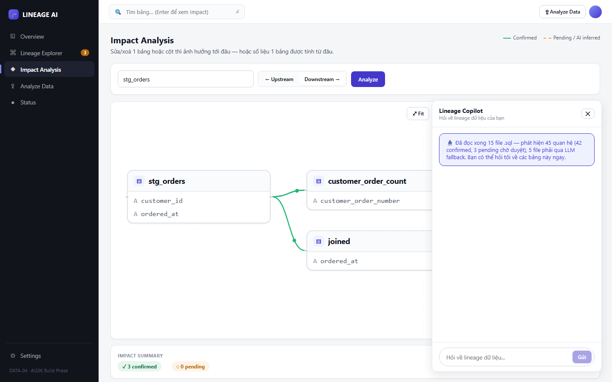 *Mở Lineage Copilot*  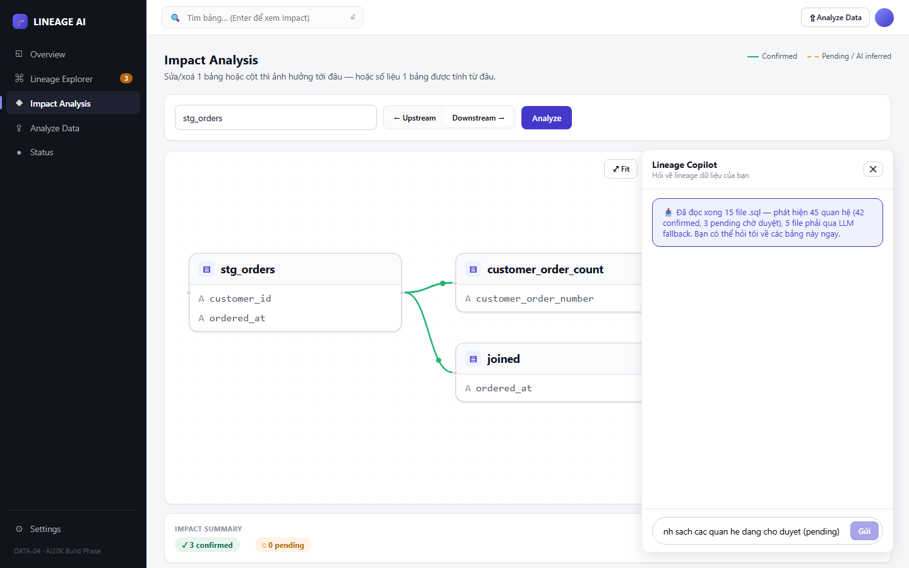 *Nhập câu hỏi*  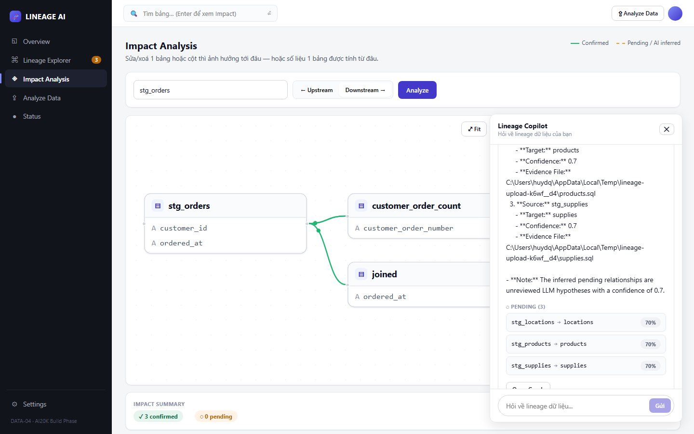 *Trả lời đúng 3 cạnh: `stg_locations→locations`, `stg_products→products`, `stg_supplies→supplies`, đều 70%, kèm card "PENDING (3)" phía dưới* |
| **Status** | ✅ PASS |

---

## TC-04 — Chatbot phân biệt "không có downstream" khác "không có dữ liệu"

| | |
|---|---|
| **Test Case** | Hỏi "xoá bảng `final`" — bảng lá thật (không bảng nào đọc từ nó) — regression test cho bug thật đã fix (agent từng trả lời như hệ thống thiếu dữ liệu, xem PR #45) |
| **Pre-conditions** | Đã chạy xong TC-01. Đang ở cùng phiên chat với TC-03 |
| **Steps** | 1. Gõ: *"Nếu tôi xoá dữ liệu trong bảng final thì ảnh hưởng đến bảng nào?"* 2. Bấm Gửi |
| **Expected Results** | Câu trả lời nói rõ "không có downstream đã xác nhận" — **không** gợi ý chạy lại ingest (dấu hiệu lỗi cũ) |
| **Actual Results** | 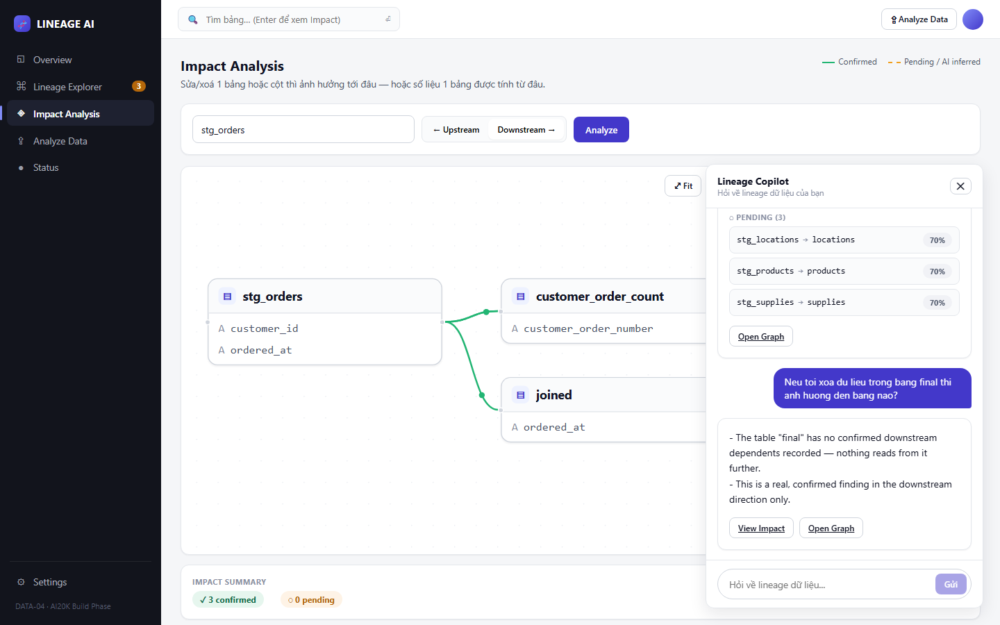 *"The table 'final' has no confirmed downstream dependents recorded — nothing reads from it further. This is a real, confirmed finding in the downstream direction only."* — đúng, không nhắc gì tới thiếu dữ liệu |
| **Status** | ✅ PASS |

---

## TC-05 — HITL Approve: duyệt 1 cạnh AI suy luận ngay trên đồ thị

| | |
|---|---|
| **Test Case** | Bấm 1 cạnh nét đứt (pending) trên đồ thị Impact Analysis, xem evidence, bấm Approve, xác nhận cạnh chuyển thành confirmed ngay trên UI — không cần tải lại trang |
| **Pre-conditions** | Query "Impact Analysis" cho bảng `stg_products` (có 1 cạnh pending `stg_products → products`) |
| **Steps** | 1. Bấm vào cạnh nét đứt màu cam (`stg_products ⇢ products`) 2. Đọc popup evidence 3. Bấm "Approve" |
| **Expected Results** | Popup hiện badge "AI INFERRED — CHỜ DUYỆT", evidence đầy đủ (file, lý do, trích dẫn SQL, % tin cậy). Sau Approve: cạnh chuyển nét liền màu xanh, Impact Summary +1 confirmed / -1 pending, badge Sidebar giảm |
| **Actual Results** | 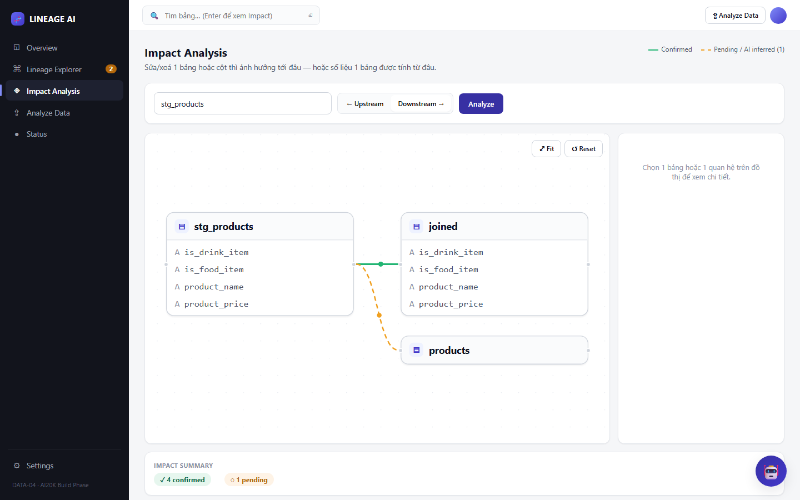 *Đồ thị: `stg_products → joined` (xanh, confirmed) và `stg_products ⇢ products` (cam, pending) — Impact Summary "4 confirmed · 1 pending"*  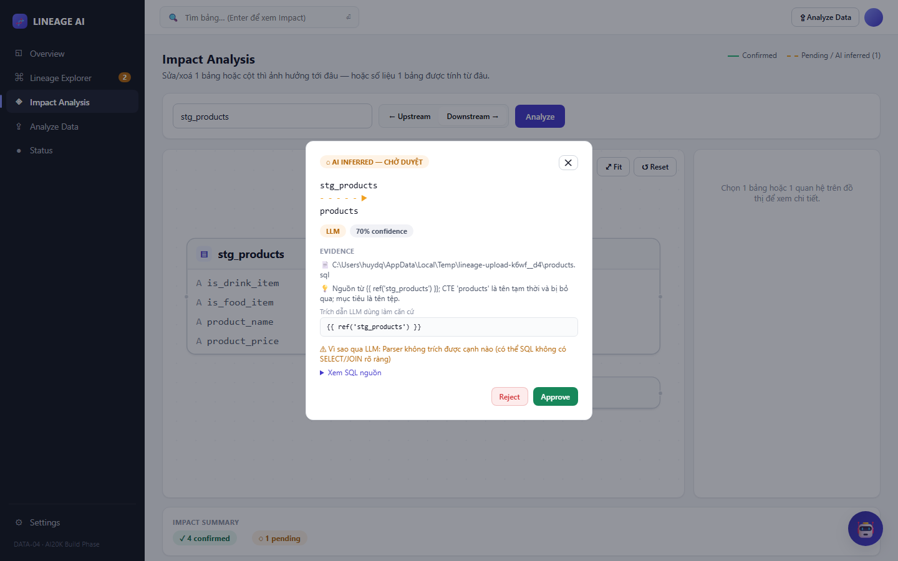 *Popup: "AI INFERRED — CHỜ DUYỆT", LLM, 70% confidence, evidence file `products.sql`, trích dẫn `{{ ref('stg_products') }}`, lý do qua LLM*  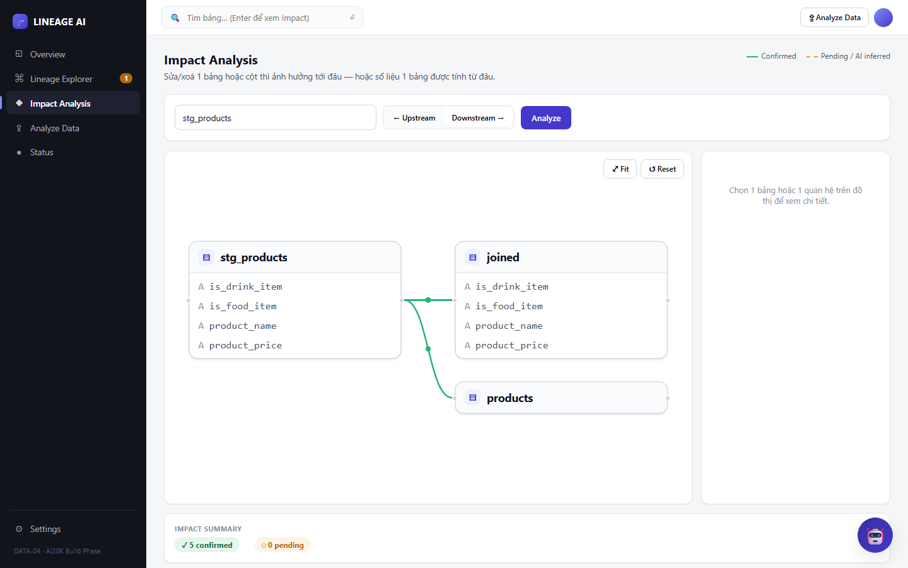 *Sau Approve: cạnh `stg_products → products` chuyển xanh liền nét, Impact Summary "5 confirmed · 0 pending", badge Sidebar "Lineage Explorer" giảm từ 2 → 1* |
| **Status** | ✅ PASS |

---

## TC-06 — HITL Reject: từ chối 1 cạnh, xác nhận biến mất khỏi đồ thị

| | |
|---|---|
| **Test Case** | Bấm 1 cạnh pending khác, bấm Reject, xác nhận cạnh biến mất hoàn toàn (không lọt vào confirmed) |
| **Pre-conditions** | Query "Impact Analysis" cho bảng `stg_locations` (có 1 cạnh pending `stg_locations → locations`) |
| **Steps** | 1. Bấm vào cạnh nét đứt (`stg_locations ⇢ locations`) 2. Đọc popup evidence 3. Bấm "Reject" |
| **Expected Results** | Sau Reject: cạnh biến mất khỏi đồ thị hoàn toàn (không xuất hiện lại dưới dạng confirmed), Impact Summary về 0/0, badge Sidebar giảm |
| **Actual Results** | 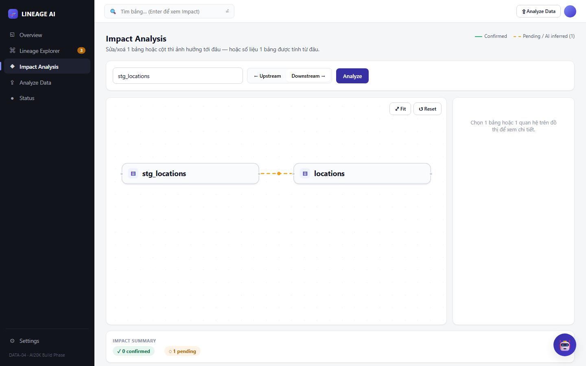 *Đồ thị hiện `stg_locations ⇢ locations` (cam, pending) — Impact Summary "0 confirmed · 1 pending"*  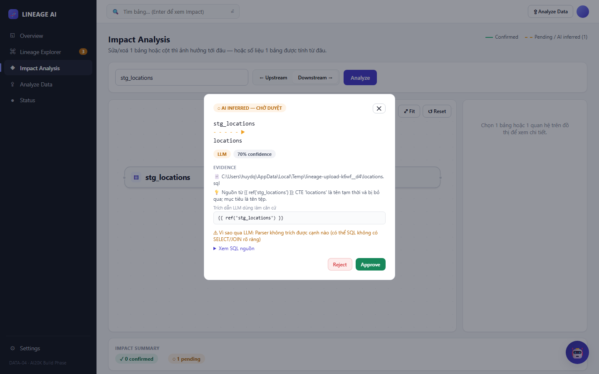 *Popup evidence đầy đủ, giống cấu trúc TC-05*  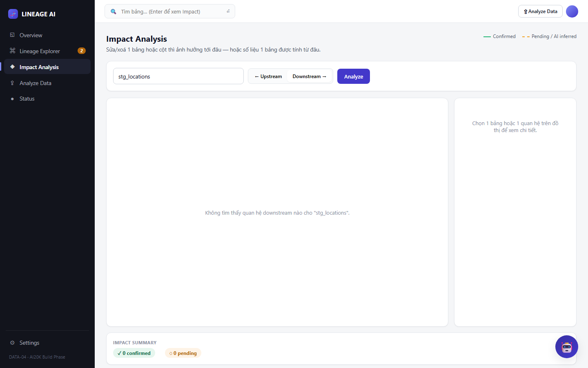 *Sau Reject: "Không tìm thấy quan hệ downstream nào cho 'stg_locations'", Impact Summary "0 confirmed · 0 pending" — cạnh không hề xuất hiện lại, badge Sidebar giảm từ 3 → 2* |
| **Status** | ✅ PASS |

---

## Tổng kết

| Test ID | Test Case | Status |
|---|---|---|
| TC-01 | Ingest qua UI (upload file thật) | ✅ PASS |
| TC-02 | Impact Analysis — downstream thật | ✅ PASS |
| TC-03 | Chatbot — câu hỏi tổng quát (regression PR #43) | ✅ PASS |
| TC-04 | Chatbot — phân biệt "0 downstream" vs "0 dữ liệu" (regression PR #45) | ✅ PASS |
| TC-05 | HITL Approve — pending → confirmed, cập nhật UI ngay | ✅ PASS |
| TC-06 | HITL Reject — biến mất hoàn toàn, cập nhật UI ngay | ✅ PASS |

**6/6 PASS**, test trực tiếp trên **sản phẩm cuối** (frontend thật, click chuột — không phải gọi API bằng tay) chạy trên backend live thật (Postgres + LLM thật qua OpenRouter, không mock). TC-03 và TC-04 là regression test cho 2 bug thật đã phát hiện và fix trong quá trình phát triển (PR #43, #45 trên GitHub).
